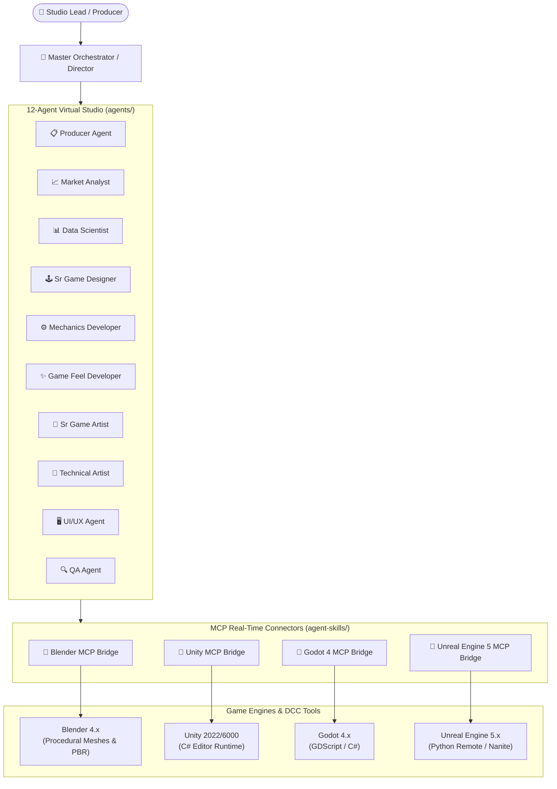

# Master Game Studio Hub 🎮🚀

[](#architecture)
[](#engine-mcp-connectors)
[](#supported-engines)
[](LICENSE)

**Master Game Studio Hub** is a unified, production-ready AI development ecosystem for game development. It combines **12 specialized game studio agent personas**, production-grade design templates, engine configurations, and **Model Context Protocol (MCP)** execution bridges for **Blender, Unity, Godot, and Unreal Engine**.

---

## 🌟 Key Pillars

### 1. 👥 The 12-Agent Virtual Studio Team (`agents/`)
Specialized agent personas structured according to professional game studio hierarchies:
- **Management Layer**: `master_orchestrator.md`, `producer_agent.md`
- **Intelligence Layer**: `market_analyst.md`, `data_scientist.md`
- **Design Team**: `sr_game_designer.md`, `mid_game_designer.md`
- **Engineering Team**: `mechanics_developer.md`, `game_feel_developer.md`
- **Art & UX Team**: `sr_game_artist.md`, `technical_artist.md`, `ui_ux_agent.md`
- **Quality Assurance**: `qa_agent.md`

### 2. 🔌 Live Engine MCP Connectors (`agent-skills/engine-mcp-connectors/`)
Bi-directional, real-time control bridges connecting AI agents directly to running game engines:
- 🎨 **Blender MCP**: Live scene inspection, headless Python automation, procedural modeling.
- ⚡ **Unity MCP**: Scene graph traversal, GameObject manipulation, AssetDatabase automation, and Playmode test execution.
- 🤖 **Godot 4 MCP**: GDScript execution, Scene tree queries, node instantiation, and resource serialization.
- 🌌 **Unreal Engine 5 MCP**: Python Remote Execution bridge, Blueprint node querying, actor placement, and Nanite/Lumen settings verification.

### 3. 📐 Procedural Pipelines & Narrative Engines (`agent-skills/`)
- **`gamestudio-director`**: High-level production lead, milestone planning, and cross-engine task delegation.
- **`narrative-quest-engine`**: Branching dialogue and quest logic exported to Yarn Spinner, Ink, Godot Dialogue Manager, and Unreal DataTables.
- **`blender-3d-pipeline`**: Procedural mesh generation, automated UV unwrapping, PBR material synthesis, LOD cascades, and batch glTF/FBX exports.

### 4. 📋 Production Templates & Automation (`templates/` & `scripts/`)
- **Templates**: GDD, Feature Specifications, Engine Setup, Analytics Setup, Handoffs, and Market Analysis.
- **Engine Configs**: Pre-configured JSON presets for Godot, Unity, and Unreal Engine.
- **Python Automation**: CLI project initialization, agent customization, and workflow validation.

---

## 🏗️ Architecture



---

## 📁 Repository Structure

```text
master-game-studio/
├── README.md                                  # Hub overview and getting started guide
├── AGENTS.md                                  # Multi-agent coordination protocols and role definitions
├── LICENSE                                    # MIT License
├── DEVELOPMENT_RULES.md                       # Studio-wide development rules and coding standards
├── SETUP.md                                   # Comprehensive multi-engine environment setup guide
├── EXAMPLES.md                                # Concrete multi-agent workflow examples
├── SYSTEM_VERIFICATION.md                     # Verification scripts and checklist
├── WORKFLOW_VALIDATION.md                     # Milestone testing and verification guide
├── package.json                               # Workspace metadata and npm scripts
├── agents/                                    # 12 Specialized Studio Agent Personas
│   ├── master_orchestrator.md
│   ├── producer_agent.md
│   ├── market_analyst.md
│   ├── data_scientist.md
│   ├── sr_game_designer.md
│   ├── mid_game_designer.md
│   ├── mechanics_developer.md
│   ├── game_feel_developer.md
│   ├── sr_game_artist.md
│   ├── technical_artist.md
│   ├── ui_ux_agent.md
│   └── qa_agent.md
├── agent-skills/                              # Standardized MCP Operational Skills
│   ├── gamestudio-director/                   # Production planning and delegation
│   ├── narrative-quest-engine/                # Branching dialogue and quest logic
│   ├── blender-3d-pipeline/                   # Headless procedural 3D modeling and LODs
│   └── engine-mcp-connectors/                 # Live engine communication bridges
│       ├── blender-mcp/
│       ├── unity-mcp/
│       ├── godot-mcp/
│       └── unreal-mcp/
├── engine_configs/                            # Standardized engine configuration presets
│   ├── godot_config.json
│   ├── unity_config.json
│   └── unreal_config.json
├── templates/                                 # Standard production document templates
│   ├── gdd_template.md
│   ├── feature_spec_template.md
│   ├── engine_setup_template.md
│   ├── analytics_setup_template.md
│   ├── handoff_template.md
│   └── market_analysis_template.md
└── scripts/                                   # Project automation and verification scripts
    ├── init_project.py
    ├── project_manager.py
    ├── agent_customizer.py
    ├── test_engine_system.py
    └── test_project_workflow.py
```

---

## 🚀 Quick Start

### 1. Initialize a Project
```bash
# Clone the repository
git clone https://github.com/kursatsndgn/master-game-studio.git
cd master-game-studio

# Run the project initializer
python scripts/init_project.py --name "ProjectNebula" --engine godot --mode full
```

### 2. Verify Your Environment
```bash
python scripts/test_engine_system.py
```

### 3. Using the Agents in Antigravity
You can invoke any role directly in chat:
- **Game Feel**: `"Act as @agents/game_feel_developer.md and review screen shake on player jump."`
- **Technical Artist**: `"Act as @agents/technical_artist.md and optimize LOD draw distance in Godot."`
- **Blender 3D Pipeline**: `"Run @blender-3d-pipeline to generate a medieval chest prop with LODs."`
- **Godot MCP**: `"Use @godot-mcp to inspect the active scene tree."`

---

## 📜 Credits & Acknowledgments
- Agent personas, templates, and Python project tooling created by [Tuna Pamir](https://github.com/pamirtuna) ([gamestudio-subagents](https://github.com/pamirtuna/gamestudio-subagents)).
- Real-time MCP connectors, procedural 3D pipelines, and multi-agent coordination hub created for **Master Game Studio Hub**.

---

## 📄 License
This project is licensed under the **MIT License** - see the [LICENSE](LICENSE) file for details.
