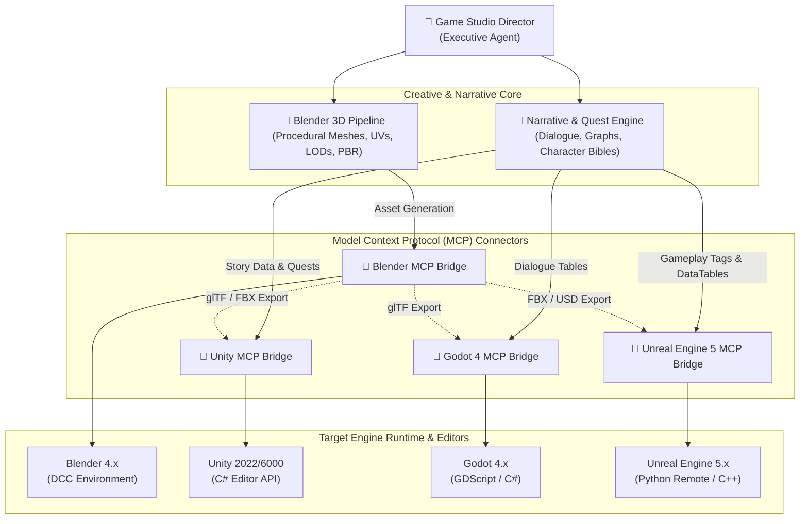

# Master Game Studio Hub 🎮🚀

[](#architecture)
[](#mcp-connectors)
[](#supported-engines)
[](LICENSE)

**Master Game Studio Hub** is a next-generation, production-ready AI development hub designed for modern game production. It unifies **Narrative Design**, **Procedural 3D Asset Pipelines**, and **Direct Engine Tooling** across Blender, Unity, Godot, and Unreal Engine through standardized **Model Context Protocol (MCP)** bridges.

---

## 🌟 Key Capabilities

- **Executive Agent Orchestration (`gamestudio-director`)**: High-level game direction, milestone planning, cross-engine task delegation, and production balance.
- **Narrative & Quest Engine (`narrative-quest-engine`)**: Branching quest graph generation, dialogue writing, character state bibles, and multi-format exports (Ink, Yarn Spinner, Godot Dialogue Manager, Unreal Gameplay Tags).
- **Automated 3D Asset Pipeline (`blender-3d-pipeline`)**: Procedural mesh generation, automated UV unwrapping, PBR material synthesis, LOD cascades, and batch glTF/FBX/USD exports.
- **Bi-Directional Engine MCP Connectors (`engine-mcp-connectors`)**:
  - 🎨 **Blender MCP**: Live scene inspection, headless Python automation, geometry node control.
  - ⚡ **Unity MCP**: Scene graph traversal, GameObject manipulation, AssetDatabase automation, and Playmode test execution.
  - 🤖 **Godot 4 MCP**: GDScript execution, Scene tree queries, node instantiation, and resource serialization.
  - 🌌 **Unreal Engine 5 MCP**: Python Remote Execution bridge, Blueprint node querying, actor placement, and Nanite/Lumen settings verification.

---

## 🏗️ Architecture



---

## 📁 Repository Structure

```text
master-game-studio/
├── README.md                                  # Hub overview and getting started guide
├── AGENTS.md                                  # Multi-agent coordination protocols and role definitions
├── .gitignore                                 # Production ignore rules across engines & DCC tools
└── agent-skills/                              # Standardized agent operational skill manifests
    ├── gamestudio-director/                   # Production planning, feature scope, and orchestration
    │   └── SKILL.md
    ├── narrative-quest-engine/                # World-building, branching dialogue, quest logic
    │   └── SKILL.md
    ├── blender-3d-pipeline/                   # Python procedural modeling, UV unwrap, LOD export
    │   └── SKILL.md
    └── engine-mcp-connectors/                 # Engine communication protocols (MCP bridges)
        ├── blender-mcp/                       # Blender RPC & Python automation server
        │   └── SKILL.md
        ├── unity-mcp/                         # Unity Editor C# bridge & Playmode runner
        │   └── SKILL.md
        ├── godot-mcp/                         # Godot 4 EditorPlugin & TCP/WebSocket bridge
        │   └── SKILL.md
        └── unreal-mcp/                        # Unreal Engine 5 Python Remote Execution bridge
            └── SKILL.md
```

---

## 🚀 Getting Started

### Prerequisites
1. **DCC & Engine Installations**:
   - Blender 4.0+
   - Unity 2022.3 LTS or Unity 6+
   - Godot Engine 4.2+
   - Unreal Engine 5.3+
2. **AI Runtime**:
   - Antigravity IDE / Antigravity Agent Runtime
   - Node.js 20+ and Python 3.10+ for MCP bridge servers

### Initial Setup
```bash
# Clone the repository
git clone https://github.com/kursatsndgn/master-game-studio.git
cd master-game-studio

# Verify workspace configuration
git status
```

### Activating Skills
Each folder inside `agent-skills/` conforms to the standardized `SKILL.md` format. When you interact with an Antigravity agent:
1. **To plan a game feature**: `"Run @gamestudio-director to scope an open-world tavern quest."`
2. **To generate quest trees**: `"Invoke @narrative-quest-engine and output in Godot Dialogue Manager format."`
3. **To generate 3D assets**: `"Use @blender-3d-pipeline to generate a low-poly iron sword with 3 LODs."`
4. **To inspect live scenes**: `"Use @engine-mcp-connectors/godot-mcp to inspect active nodes in the main scene."`

---

## 🛠️ MCP Connector Protocols

| Engine | Primary Transport | Host Script / Plugin | Key Tools |
| :--- | :--- | :--- | :--- |
| **Blender** | stdio / Local Socket | `bpy_mcp_addon.py` | `blender_exec_script`, `blender_inspect_scene`, `blender_export_asset` |
| **Unity** | HTTP / WebSocket | `UnityMcpEditorBridge.cs` | `unity_get_scene_hierarchy`, `unity_instantiate_prefab`, `unity_run_playmode_tests` |
| **Godot 4** | WebSocket / TCP | `godot_mcp_plugin.gd` | `godot_get_tree`, `godot_run_gdscript`, `godot_instantiate_packed_scene` |
| **Unreal Engine 5** | UDP / Web Remote Control | UE Python Remote Execution | `unreal_execute_python`, `unreal_spawn_actor`, `unreal_query_assets` |

---

## 📜 Contributing & Governance
See [AGENTS.md](AGENTS.md) for multi-agent interaction rules, message payloads, error-handling conventions, and schema contracts.
