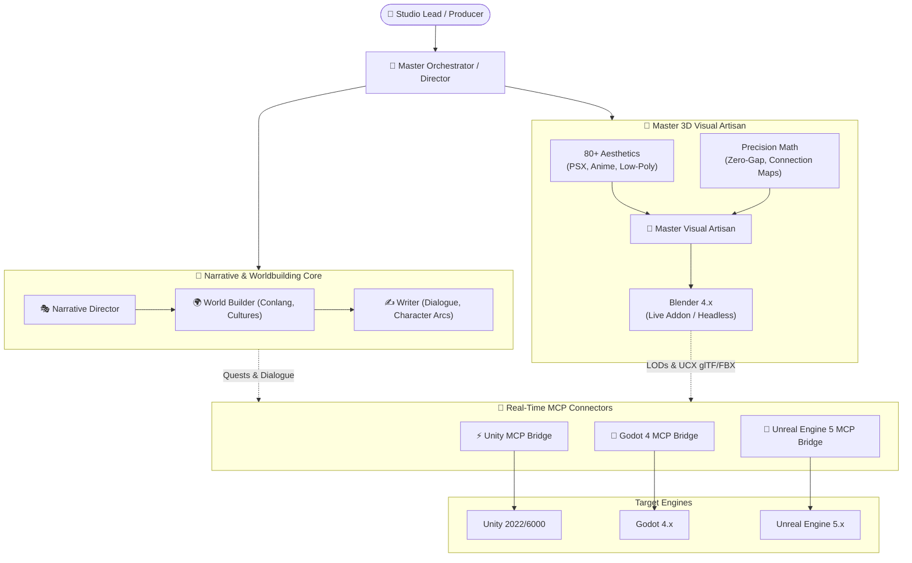

# Master Game Studio Hub 🎮🚀

[](#multi-assistant-support)
[](#architecture)
[](#engine-mcp-connectors)
[](#blender-visual-production)
[](#narrative--creative-writing)
[](LICENSE)

**Master Game Studio Hub** is an elite, multi-engine AI game development platform. It unifies a **12-agent core studio team**, **specialist discipline roles**, a massive **narrative & worldbuilding engine**, a **master 3D visual artisan pipeline** with 80+ Blender aesthetic skills, and real-time **Model Context Protocol (MCP)** execution bridges for **Blender, Unity, Godot, and Unreal Engine**.

---

## 🌟 Key Pillars

### 1. 👥 Complete Game Studio Team (`agents/`)
- **Core 12 Personas (`agents/`)**: Master Orchestrator, Producer, Market Analyst, Data Scientist, Sr/Mid Game Designers, Mechanics Dev, Game Feel Dev, Sr Game Artist, Technical Artist, UI/UX Agent, QA Agent.
- **Specialist Roles (`agents/specialists/`)**:
  - 🎭 **Narrative & Story**: `narrative-director.md`, `world-builder.md`, `writer.md`
  - ⚔️ **Combat & Systems**: `combat-designer.md`, `level-designer.md`, `economy-designer.md`
  - 🎧 **Audio & Tech**: `sound-designer.md`, `gameplay-programmer.md`, `network-programmer.md`, `tools-programmer.md`
  - 🎨 **Master 3D Visual Artisan**: `master-visual-artisan.md` (Aesthetic mastery + assembly mathematics)

### 2. 🔮 Narrative & Worldbuilding Engine (`agent-skills/creative-writing/`)
- **Interactive Fiction Diagnosis**: False choice detection, branching narrative explosion containment.
- **Systemic Worldbuilding**: Conlang generation, cosmology, metabolic cultures, economic systems, and settlement design.
- **Character Crafting**: Phoneme-based cultural naming generators, psychological wound maps, and voice profiles.
- **Narrative Rules & Quality Gates**: Canon level tracking (`Established`, `Provisional`, `Under Review`), dialogue length constraints (120 chars), and Story-Ready director gates.

### 3. 🎨 Master Blender 3D Visual Artisan (`agent-skills/blender-master-artisan/`)
Synthesizes the best of open-source 3D AI tooling:
- **80+ Production Styles (`agent-skills/blender-skills/`)**: PSX Horror, Anime/Cel-shaded, Hand-Painted Fantasy, Low-Poly, Voxel, Retro 8/16-bit, Cyberpunk, Soulslike, Realistic, Liminal Spaces, Biomes.
- **Precision Assembly Math (`blender-assembly/SKILL.md`)**: Connection planning, cube size math fix, cylinder Quaternion alignment, and zero-gap overlap guarantees.
- **Blender Live Execution & Addon (`tools/blender-llm-addon/`)**: Runtime addon for interactive in-Blender agent control.
- **Multi-Engine Automated Export**: glTF/GLB with collision hulls (`UCX_`) for Godot/Unity, and FBX/Nanite setups for Unreal Engine 5.

### 4. 🔌 Live Engine MCP Connectors (`agent-skills/engine-mcp-connectors/`)
- **Blender MCP**: Headless Python script execution, scene inspection, and camera render capture.
- **Unity MCP**: Scene hierarchy traversal, prefab instantiation, AssetDatabase reload, and Playmode test runner.
- **Godot 4 MCP**: SceneTree inspection, node instantiation, GDScript evaluation, and FileSystem scanning.
- **Unreal Engine 5 MCP**: Python Remote Execution, Actor spawning, Nanite/Lumen inspection, and Asset Registry queries.

---

## 🏗️ Master Studio Architecture



---

## 📁 Repository Structure

```text
master-game-studio/
├── README.md                                  # Hub overview and getting started guide
├── AGENTS.md                                  # Multi-agent coordination protocols and role definitions
├── LICENSE                                    # MIT License
├── DEVELOPMENT_RULES.md                       # Studio-wide development rules and coding standards
├── SETUP.md                                   # Multi-engine environment setup guide
├── EXAMPLES.md                                # Workflow examples
├── package.json                               # Workspace metadata
├── rules/
│   └── narrative.md                           # Canon tracking and dialogue box constraints
├── agents/                                    # 12 Core Studio Personas
│   ├── master_orchestrator.md
│   ├── producer_agent.md
│   ├── market_analyst.md
│   ├── data_scientist.md
│   ├── sr_game_designer.md
│   ├── mid_game_designer.md
│   ├── mechanics_developer.md
│   ├── game_feel_developer.md
│   ├── sr_game_artist.md
│   ├── technical_artist.md
│   ├── ui_ux_agent.md
│   ├── qa_agent.md
│   └── specialists/                           # Specialist Discipline Roles
│       ├── master-visual-artisan.md           # Master 3D Visual Artisan Agent
│       ├── narrative-director.md              # Narrative Director
│       ├── world-builder.md                   # World & Lore Builder
│       ├── writer.md                          # Screenwriter & Dialogue Writer
│       ├── combat-designer.md                 # Combat & Encounter Designer
│       ├── level-designer.md                  # Level & Pacing Designer
│       ├── economy-designer.md                # In-Game Economy & Loot Designer
│       └── sound-designer.md                  # Audio & Adaptive Music Designer
├── agent-skills/
│   ├── blender-master-artisan/                # Master 3D Visual Generation Skill
│   ├── blender-skills/                        # 80+ Aesthetic & Technique Skills
│   │   ├── blender-assembly/                  # Zero-gap mathematical assembly
│   │   ├── anime-style/, psx-horror-style/, lowpoly-style/
│   │   ├── procedural-modeling/, geometry-nodes/, rigging/
│   │   └── godot-export/, unity-export/, unreal-export/
│   ├── creative-writing/                      # Narrative & Fiction Craft Skills
│   │   ├── interactive-fiction/               # Branching narrative diagnostics
│   │   ├── worldbuilding/                     # Conlang, belief systems, cultures
│   │   ├── character/                         # Naming generators, arcs, voice
│   │   └── game-facilitator/                  # Dynamic NPC & complication engine
│   ├── godot-best-practices/                  # State machines, object pooling, save systems
│   ├── studio-pipeline/                       # Production Pipeline Skills
│   │   ├── vertical-slice/                    # 15-minute playable slice protocol
│   │   ├── art-bible/                         # Visual style specifications
│   │   └── balance-check/                     # Mathematical game balancing
│   └── engine-mcp-connectors/                 # Bi-Directional Engine MCP Connectors
│       ├── blender-mcp/
│       ├── unity-mcp/
│       ├── godot-mcp/
│       └── unreal-mcp/
├── tools/
│   └── blender-llm-addon/                     # Interactive Blender runtime addon
├── engine_configs/                            # Engine configuration presets
│   ├── godot_config.json
│   ├── unity_config.json
│   └── unreal_config.json
├── templates/                                 # Standard production document templates
│   ├── gdd_template.md
│   ├── feature_spec_template.md
│   ├── narrative-character-sheet.md
│   └── director-gates/
└── scripts/                                   # Project automation and verification scripts
    ├── init_project.py
    ├── project_manager.py
    └── test_engine_system.py
```

---

## 🚀 Quick Start

### 1. Narrative & World Creation
```bash
# In Antigravity Chat:
"Act as @agents/specialists/narrative-director.md and help me design a post-apocalyptic Mediterranean fishing village with its own conlang and belief system."
```

### 2. 3D Visual Generation
```bash
# In Antigravity Chat:
"Use @blender-master-artisan to generate a low-poly stylized wooden rowboat with oars, complete with convex collision and export for Godot 4."
```

### 3. Live Engine Integration
```bash
# In Antigravity Chat:
"Use @godot-mcp to inspect the active scene tree and place the newly generated rowboat at coordinates (0, 0, 0)."
```

---

## 🤖 Universal AI Assistant Support

Master Game Studio Hub is universally compatible across modern AI coding environments out of the box:

| AI Environment | Instruction Files Loaded | Features Supported |
| :--- | :--- | :--- |
| **Antigravity** | `GEMINI.md`, `AGENTS.md`, `.agents/rules/*.md` | Automatic Studio Conductor, MCP Bridges, Progressive Skills. |
| **Claude Code** | `CLAUDE.md`, `.claude/` | Full terminal execution, sub-agent spawning, automated tool loops. |
| **Cursor IDE** | `.cursorrules`, `.cursor/rules/*.mdc` | Semantic rule loading, inline feature generation, live diagnostics. |
| **OpenAI Codex / Copilot** | `CODEX.md` | Contextual system prompts, multi-agent delegation. |

---

## ⚡ Feature Addition & Decomposition Pipeline

Whenever you or your team want to implement a new feature (e.g. inventory, boss battle, procedural dungeons):
1. **Request the feature naturally**: *"Let's add a stamina-based dodge roll mechanic"* or *"Envanter sistemi kuralım"*.
2. **Conductor Analyzes & Generates**: Writes `features/[feature_name]/SPEC.md` using [`templates/feature_spec_template.md`](templates/feature_spec_template.md).
3. **Automatic Multi-Agent Decomposition**:
   - **Game Design**: Mechanics rules, state transitions, balancing formulas.
   - **Narrative**: Story justification, quest connections, lore tags.
   - **3D Art**: Asset briefs, LODs, UCX collision via `@blender-master-artisan`.
   - **Engineering**: Code architecture via `@mechanics_developer`.
   - **Game Feel**: Camera shake, audio, hit-stop juice via `@game_feel_developer`.
   - **QA**: Acceptance criteria (Must/Should/Could have) via `@qa_agent`.
4. **Phased Implementation**: The Conductor executes and commits each step cleanly.

---

## 📜 Credits & Attributions
- **Game Studio Sub-Agents**: Created by [Tuna Pamir](https://github.com/pamirtuna) ([gamestudio-subagents](https://github.com/pamirtuna/gamestudio-subagents)).
- **Creative Writing & Fiction Skills**: Created by [J. Wynia](https://github.com/jwynia) ([agent-skills](https://github.com/jwynia/agent-skills)).
- **Studio Roles & Narrative Governance**: Inspired by [Donchitos](https://github.com/Donchitos) ([Claude-Code-Game-Studios](https://github.com/Donchitos/Claude-Code-Game-Studios)).
- **Blender Skills Library**: Created by [Arjun](https://github.com/arjun988) ([blender-skills](https://github.com/arjun988/blender-skills)).
- **Blender Assembly Geometric Protocols**: Created by [ProfRino](https://github.com/ProfRino) ([Blender-MCP-Assembly-Skill](https://github.com/ProfRino/Blender-MCP-Assembly-Skill)).
- **Blender LLM Runtime Addon**: Created by [Saofund](https://github.com/saofund) ([LLM-Blender-Agent](https://github.com/saofund/LLM-Blender-Agent)).

---

## 📄 License
This project is licensed under the **MIT License** - see the [LICENSE](LICENSE) file for details.
