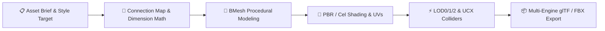

# Blender Master Artisan Skill

The **Blender Master Artisan** skill is an integrated visual production pipeline for generating production-ready 3D game assets inside Blender. It unifies stylistic artistry, connection geometry mathematics, live execution feedback, and automated export pipelines.

---

## 🛠️ Complete Operational Pipeline



---

## 1. Quick Invocation Guide

When asking an agent to generate 3D assets:
- **Low-poly chest:** `"Use @blender-master-artisan to generate a low-poly fantasy chest for Godot."`
- **Sci-fi terminal:** `"Use @blender-master-artisan to model a cyberpunk computer terminal with emissive screens for Unreal Engine."`
- **Anime character prop:** `"Use @blender-master-artisan to build a stylized anime magical staff with outline shaders."`

---

## 2. Integrated Code Blueprint Template

```python
import bpy
import bmesh
import math
from mathutils import Vector, Quaternion

def init_clean_canvas():
    """Resets the scene to ensure clean coordinate space."""
    bpy.ops.wm.read_factory_settings(use_empty=True)

def create_master_prop(asset_name="SM_Prop", style="stylized"):
    """
    Constructs a precision assembled game asset enforcing:
    1. Zero-gap overlap
    2. Proper transform application
    3. Manifold collision hull
    """
    mesh = bpy.data.meshes.new(f"{asset_name}_Mesh")
    obj = bpy.data.objects.new(asset_name, mesh)
    bpy.context.collection.objects.link(obj)
    bpy.context.view_layer.objects.active = obj

    bm = bmesh.new()
    
    # 1. Base Structure (Dimension Math)
    base_box = bmesh.ops.create_cube(bm, size=1.0)
    bmesh.ops.scale(bm, vec=(1.2, 0.8, 0.6), verts=bm.verts)
    # Pivot at bottom
    bmesh.ops.translate(bm, vec=(0.0, 0.0, 0.3), verts=bm.verts)

    # 2. Bevel for High-End Game Rendering
    bmesh.ops.bevel(bm, geom=bm.edges, offset=0.03, segments=2, profile=0.5)

    bm.to_mesh(mesh)
    bm.free()

    # Apply transforms
    bpy.ops.object.transform_apply(location=True, rotation=True, scale=True)

    # 3. Smart UV Packing with bleed margin
    bpy.ops.object.mode_set(mode='EDIT')
    bpy.ops.mesh.select_all(action='SELECT')
    bpy.ops.uv.smart_project(angle_limit=math.radians(66), island_margin=0.02)
    bpy.ops.object.mode_set(mode='OBJECT')

    return obj

def apply_style_material(obj, style="stylized", base_color=(0.15, 0.45, 0.85, 1.0)):
    """Sets up style-specific shader node graphs."""
    mat = bpy.data.materials.new(name=f"M_{obj.name}")
    mat.use_nodes = True
    bsdf = mat.node_tree.nodes.get("Principled BSDF")

    if style == "lowpoly":
        # Flat shading
        for poly in obj.data.polygons:
            poly.use_smooth = False
        bsdf.inputs['Roughness'].default_value = 0.9
        bsdf.inputs['Base Color'].default_value = base_color
    elif style == "stylized":
        for poly in obj.data.polygons:
            poly.use_smooth = True
        bsdf.inputs['Roughness'].default_value = 0.4
        bsdf.inputs['Base Color'].default_value = base_color
        # Add subtle clearcoat/specular highlight
        bsdf.inputs['Specular IOR Level'].default_value = 0.6

    obj.data.materials.append(mat)
    return mat

def create_collision_and_export(obj, export_path, engine="godot"):
    """Creates convex hull collider (UCX_) and exports asset."""
    # Collision Hull
    col_mesh = obj.data.copy()
    col_obj = bpy.data.objects.new(f"UCX_{obj.name}_01", col_mesh)
    bpy.context.collection.objects.link(col_obj)

    # Export formats based on target engine
    if engine in ["godot", "unity"]:
        bpy.ops.export_scene.gltf(
            filepath=export_path,
            export_format='GLB',
            use_selection=False,
            export_apply=True,
            export_yup=True
        )
    elif engine == "unreal":
        bpy.ops.export_scene.fbx(
            filepath=export_path,
            use_selection=False,
            apply_unit_scale=True,
            axis_forward='X',
            axis_up='Z'
        )

if __name__ == "__main__":
    init_clean_canvas()
    prop = create_master_prop()
    apply_style_material(prop)
    create_collision_and_export(prop, "SM_MasterProp.glb", engine="godot")
```

---

## 3. Reference Library Integration

This skill links directly with:
- **80+ Art Styles**: Located in [`agent-skills/blender-skills/`](file:///C:/Users/kursa/.gemini/antigravity/scratch/master-game-studio/agent-skills/blender-skills)
- **Assembly Math & Prevention**: [`agent-skills/blender-skills/blender-assembly/SKILL.md`](file:///C:/Users/kursa/.gemini/antigravity/scratch/master-game-studio/agent-skills/blender-skills/blender-assembly/SKILL.md)
- **Live Blender Add-on Runtime**: [`tools/blender-llm-addon/`](file:///C:/Users/kursa/.gemini/antigravity/scratch/master-game-studio/tools/blender-llm-addon)
- **Engine Connectors**: [`agent-skills/engine-mcp-connectors/`](file:///C:/Users/kursa/.gemini/antigravity/scratch/master-game-studio/agent-skills/engine-mcp-connectors)
